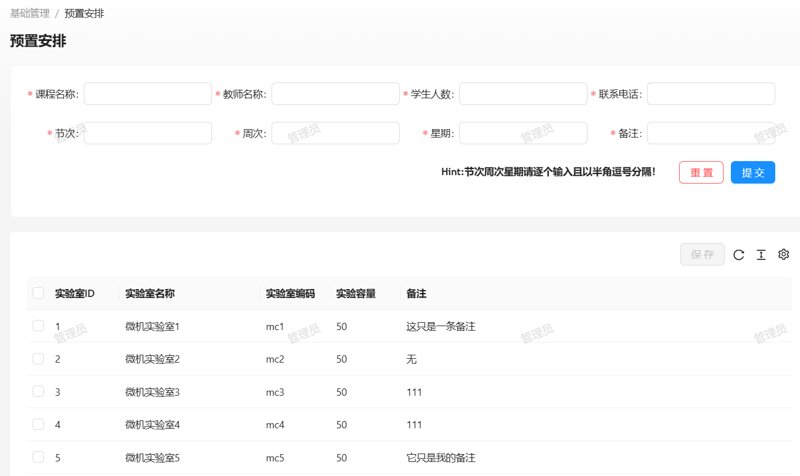
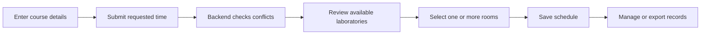
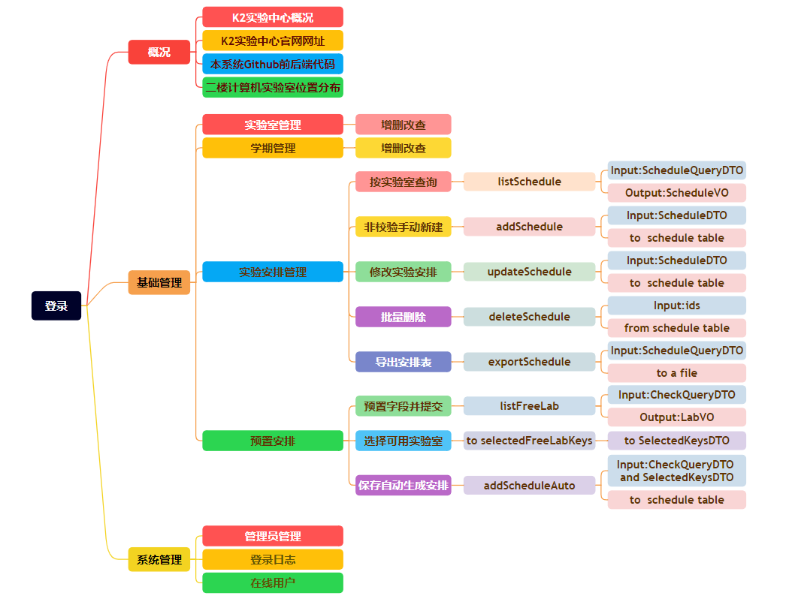

# Laboratory Reservation System · Web Frontend

**An administrator-facing React application for finding available laboratories and managing semesters, teaching schedules, operators, and audit records.**

[](package.json)
[](tsconfig.json)
[](package.json)
[](config/config.ts)
[](LICENSE)

This repository contains the web client for a full-stack software-engineering course project. It combines Ant Design Pro administration patterns with a custom reservation flow backed by [lab-reservation-system-web-backend](https://github.com/JaspinXu/lab-reservation-system-web-backend).



## What this project demonstrates

- Role- and privilege-aware routes, menus, actions, and page access.
- CRUD workflows for laboratories, semesters, and teaching schedules.
- A two-stage reservation flow that searches for available rooms before saving a schedule.
- Multi-select laboratory assignment for classes that need more than one room.
- Administrator and permission configuration, login-log browsing, and online-user management.
- Excel import/export actions connected to the backend.
- Reusable table, form, chart, file-transfer, and dialog utilities.
- Typed API integration through Umi Max and a local development proxy.

## Reservation workflow



The form sends the requested periods, weeks, and weekdays to the backend. The returned free-laboratory list supports row selection, after which the application creates schedule records with the latest configured semester.

## Application modules

| Area | Pages and responsibilities |
| --- | --- |
| Overview | Project context and laboratory-center information |
| Laboratories | Search, create, edit, delete, import, and export laboratory records |
| Semesters | Maintain academic terms used during automatic scheduling |
| Schedules | Search and maintain completed schedule records; import or export Excel files |
| Preset reservation | Enter course requirements, find available rooms, and create schedules |
| Administrators | Maintain operator accounts and module-level privileges |
| Login logs | Review authentication activity |
| Online users | Inspect active sessions and force sign-out |

<details>
<summary>Original functional map</summary>



</details>

## Tech stack

| Area | Technology |
| --- | --- |
| UI | React 18, Ant Design 5, Ant Design Pro Components |
| Application framework | Umi Max 4 |
| Language | TypeScript 4.8 |
| Charts | ECharts 5 |
| Quality | ESLint, Prettier, Jest, TypeScript |
| Package manager | pnpm |

## Quick start

### Requirements

- Node.js 16 or newer
- pnpm
- The backend running on `http://localhost:9311`

```bash
git clone https://github.com/JaspinXu/lab-reservation-system-web-frontend.git
cd lab-reservation-system-web-frontend
pnpm install
pnpm dev
```

Open `http://localhost:8000`. The `dev` script disables Umi's mock middleware so `/api/` requests pass through the proxy in [`config/proxy.ts`](config/proxy.ts) to the local backend.

To start the default Umi development mode with the bundled mock handlers enabled where available, run:

```bash
pnpm start
```

## Useful commands

```bash
pnpm dev            # development server, mocks disabled, local backend proxy enabled
pnpm start          # default Umi development server with bundled mocks available
pnpm build          # production build
pnpm lint           # ESLint, Prettier, and TypeScript checks
pnpm test           # Jest test suite
pnpm test:coverage  # tests with coverage
pnpm openapi        # regenerate API bindings from an OpenAPI document
```

## Backend connection

Development requests beginning with `/api/` are forwarded to `http://localhost:9311`. The Umi development proxy does not apply to a static production build, so a deployment must serve the frontend behind a matching reverse proxy or configure an equivalent API origin.

- Backend repository: [lab-reservation-system-web-backend](https://github.com/JaspinXu/lab-reservation-system-web-backend)
- Swagger UI after backend startup: `http://localhost:9311/swagger-ui/index.html`

## Repository guide

```text
config/
  routes.ts                         Routes and access-control declarations
  proxy.ts                          Local backend proxy
docs/images/
  reservation-workflow.png         Screenshot recovered from the course presentation
  feature-map.png                  Original frontend-oriented functional map
src/
  pages/base/lab/                   Laboratory management
  pages/base/semester/              Semester management
  pages/base/schedule/              Schedule management
  pages/base/preset/                Availability search and automatic scheduling
  pages/system/                     Administrators, login logs, and online users
  pages/User/                       Authentication UI
  components/                       Shared charts and interface components
  utils/                            Request, file, download, hook, and UI helpers
mock/                               Local mock handlers
tests/                              Frontend test setup
```

## Scope and limitations

This repository preserves a 2023–2024 course implementation as a portfolio artifact. It retains the original Ant Design Pro foundation and development assumptions rather than presenting a production deployment. A production version would need deployment-specific API routing, stronger end-to-end validation, broader automated tests, accessibility review, and the authentication hardening described in the backend repository.

The screenshots and functional map were recovered from the original project presentation; personal and assessment-only materials were intentionally left out of the repository.

## License

[MIT](LICENSE)
